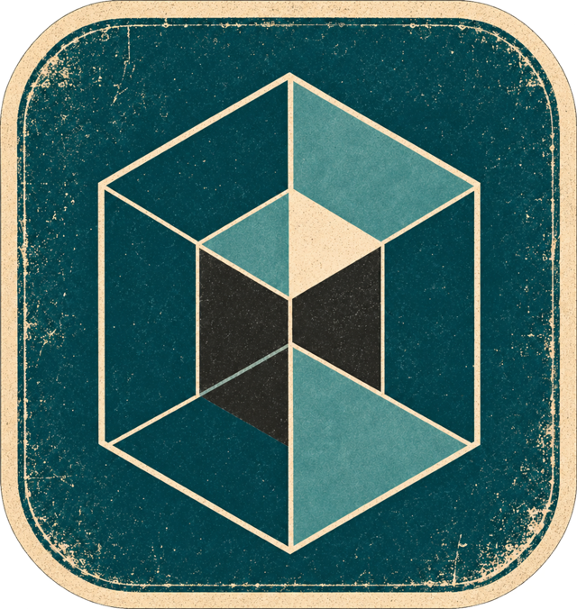

<p align="center">
  
</p>

<h1 align="center">Control</h1>

<p align="center">
  A small tiling window manager for macOS.<br>
  No config file, no macOS Spaces, no System Integrity Protection changes. Under 800 lines of Swift you can read.
</p>

---

- Windows **tile on their own**: a new window splits the focused one, a closed one gives its space back.
- Every window lives on a **desk**. The main monitor shows one desk at a time; each extra monitor is one more desk.
- Dialogs and fixed-size windows **float**.
- The menu bar shows the current desk. Click it to see every desk and its apps.

## Keys

| Key                       | Action                         |
| ------------------------- | ------------------------------ |
| Option + desk key         | Show desk                      |
| Option + Shift + desk key | Send window to desk            |
| Option + Tab              | Previous desk                  |
| Option + H/J/K/L          | Focus left/down/up/right       |
| Option + Shift + H/J/K/L  | Swap with neighbor             |
| Option + Minus / Equal    | Shrink / grow                  |
| Option + Shift + F        | Toggle fullscreen              |
| Option + Shift + Space    | Toggle floating                |

Desk keys: 1–9 and every letter except F, H, J, K, L.

## Install

Needs macOS 14+ and Xcode or the Command Line Tools.

```sh
./bundle.sh
cp -R Control.app /Applications/
open /Applications/Control.app
```

Allow the **Accessibility** permission when asked, then open Control again. It starts at login from then on.

Each rebuild needs the permission again, unless you sign with your own certificate
(Keychain Access → Certificate Assistant → Create a Certificate…, name it `Control Signing`, type **Code Signing**):

```sh
SIGN_IDENTITY="Control Signing" ./bundle.sh
```

To quit: menu bar → Quit Control. Hidden windows come back on screen first.

## Settings

Edit the top of `Sources/Control/main.swift` and rebuild:

```swift
let gap: CGFloat = 8
let resizeStep: CGFloat = 0.05
let deskKeys = "123456789ABCDEGIMNOPQRSTUVWXYZ".map(String.init)
```

## Known limits

- Option + letter no longer types special characters (like Option + E for é).
- Apps with a minimum size (Finder) can stick out of a small tile.
- Hidden windows are parked in a corner of the main monitor; with monitors beside or below it, a one-point sliver can show.
